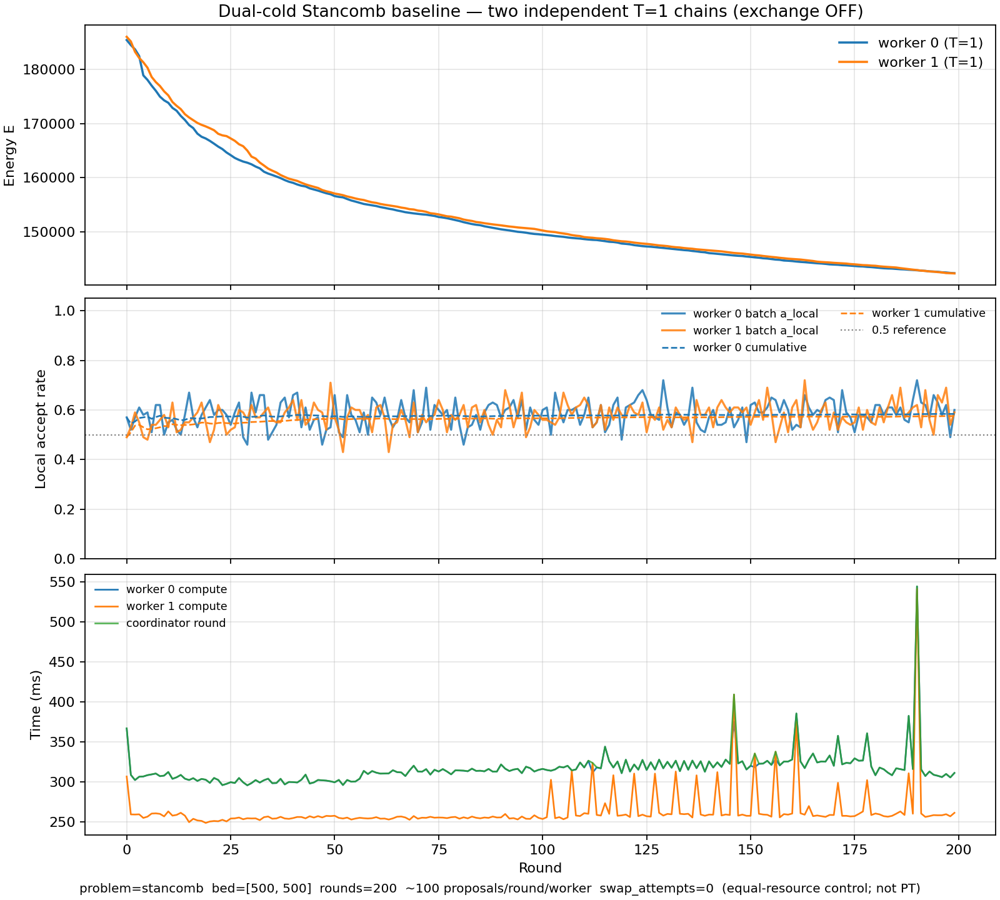
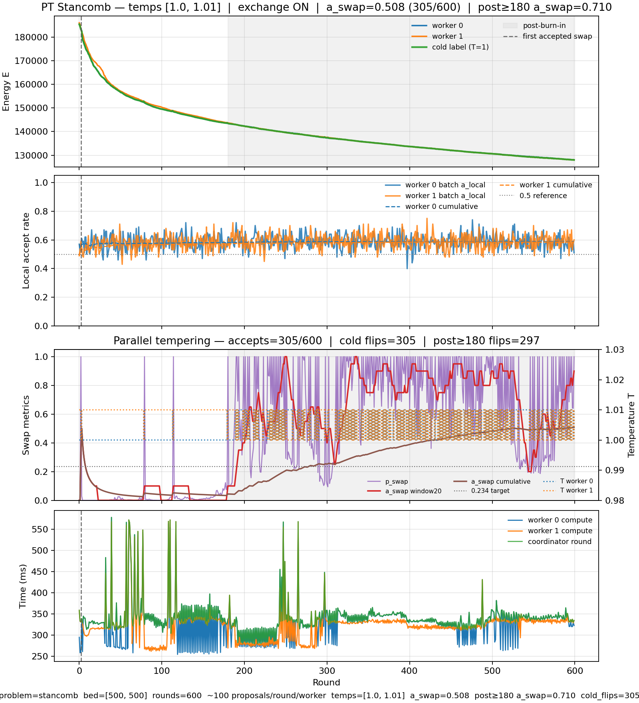
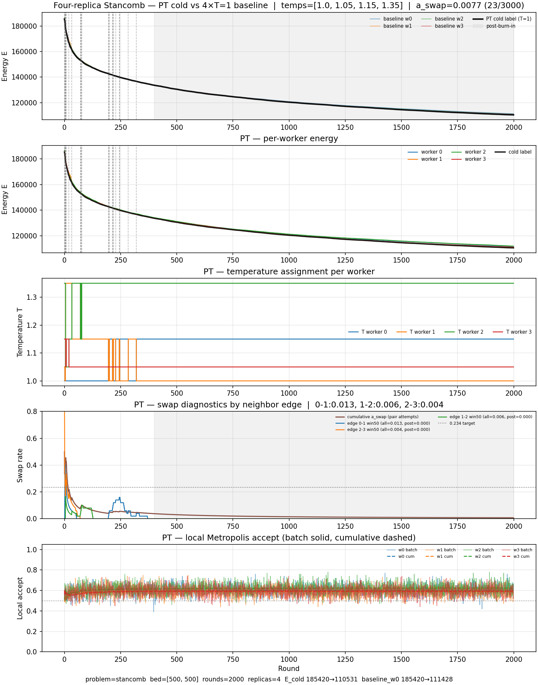
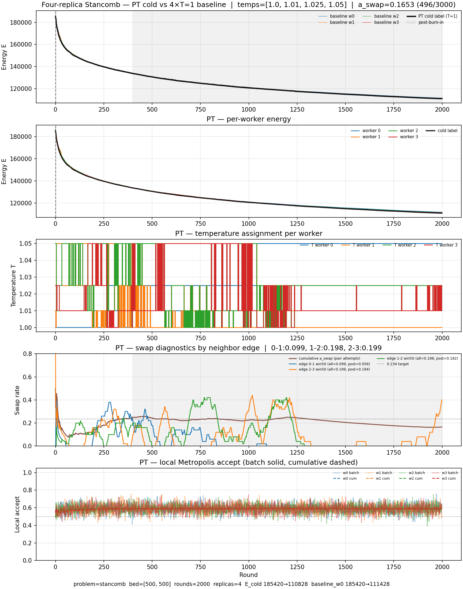

# Distributed MCMC State-Exchange Runtime

**Equal-resource parallel tempering (PT) for glacier bed / topography inverse problems**, with a Python coordinator + replica workers on UF HiPerGator today, and a path toward a C++ / multi-node / GPU runtime.

This project wraps Niya’s geostatistical MCMC (`gstatsMCMC` / Stancomb Wills CRF) in a **distributed state-exchange runtime**: workers run local MCMC batches; a coordinator proposes **temperature swaps** between neighbors and records swap / energy / accept diagnostics under matched compute budgets.

> **Status (draft milestone):** Runtime + N-replica PT are working on HiPerGator. Dense temperature ladders restore swap health. We do **not** yet claim a decisive scientific win of PT over matched multi-cold baselines on final energy. GPU/C++ scale-up is next.

---

## Project description

| Piece | Role |
|-------|------|
| **Science core** | Stancomb Wills bed inference via conditional random-field MCMC (`MCMC_implementation/gstatsMCMC/`) |
| **Adapter** | Batch `run(n)` wrapper with checkpoint / temperature / energy hooks |
| **Workers** | Outbound TCP clients; one process per replica |
| **Coordinator** | Listens; barrier → neighbor odd/even swap proposals → assign temperatures |
| **Experiment UI** | **YAML configs** + CLI launcher (no graphical UI yet) |

**Research framing:** Can temperature-exchange PT improve mixing for Stancomb under an **equal-resource** baseline (same replicas × rounds × proposals), and what runtime does that require?

Literature target for neighbor swap acceptance is roughly **20–40%** (Kone & Kofke / Atchadé; Vousden–Farr–Mandel). With only two rungs, a “hot” end that explores tends to kill swaps; useful PT needs **more rungs** and careful spacing.

---

## Is the “user interface” the YAML configs?

**Yes — for now.** Experiments are driven by YAML under `MCMC_implementation/configs/` (temperatures, replica count, exchange on/off, rounds, seeds, output dir). You launch with a Python CLI that reads that file and spawns the coordinator + workers. There is **no GUI**; terminal logs and PNG diagnostics are the human-facing feedback.

Example knobs in a config:

```yaml
sampling:
  replicas: 4
  temperatures: [1.0, 1.01, 1.025, 1.05]
  batch_n_iterations: 101
  rounds: 2000
exchange:
  enabled: true
  pairing: neighbor_odd_even
```

---

## Figures (progress so far)

### Matched dual-cold baseline (exchange OFF)



*Four independent cold chains provide the equal-resource control for PT comparisons.*

### 2-replica swap health (`T = [1.0, 1.01]`, 600 rounds)



*Overall `a_swap ≈ 0.51` (post-burn-in ≈ 0.71); many cold-label flips; local Metropolis accept unchanged by swaps.*

### 4-replica dead ladder (`T = [1.0, 1.05, 1.15, 1.35]`)



*Sparse / hot ladder: `a_swap ≈ 0.008`; temperatures freeze after ~350 rounds.*

### 4-replica dense cold ladder (`T = [1.0, 1.01, 1.025, 1.05]`)



*Same budget, denser spacing: `a_swap ≈ 0.165` (496/3000). Mid/hot edges ~0.20; cold edge still the bottleneck late in the run. Final PT cold energy ≈ matched 4×T=1 baseline — **mixing restored, energy win not yet shown**.*

---

## Repository layout

```text
MCMC_implementation/
  configs/          # YAML experiment interface
  scripts/          # launch + plot helpers
  workers/          # coordinator, replica worker, protocol
  adapters/         # topography / MCMC adapter
  gstatsMCMC/       # science library (local copy)
  data/             # Stancomb inputs (cluster path may differ)
assets/readme/      # figures embedded in this README
benchmarks/         # archived run metrics (local; often gitignored)
docs/               # design notes + poster handoff
figures/            # generated plots (local; gitignored except README)
cpp_runtime/        # future C++ runtime scaffold
```

---

## Setup

```bash
# from repo root
conda env create -f MCMC_implementation/environment.yml
conda activate gstatsMCMC

# or on HiPerGator (example path used in class Blue space):
# conda activate /blue/gly4930/<user>/mcmc_runtime/envs/gstatsMCMC
```

Requires Python 3.12+, NumPy, and the science stack in `environment.yml` (including `gstatsim`).

---

## Usage (run an experiment)

From the **repo root**, with the conda env active, on a machine with enough CPUs for the replica count (do **not** run long Stancomb jobs on a HiPerGator login node):

```bash
# Matched 4× cold baseline (exchange OFF)
python MCMC_implementation/scripts/run_two_replica_pt.py \
  --config MCMC_implementation/configs/four_replica_stancomb_baseline_cold.yaml

# 4-replica PT dense ladder (exchange ON)
python MCMC_implementation/scripts/run_two_replica_pt.py \
  --config MCMC_implementation/configs/four_replica_stancomb_pt.yaml
```

Sequential campaign (baseline then PT):

```bash
bash MCMC_implementation/scripts/run_stancomb_long_campaign.sh
```

HiPerGator interactive pattern (adjust account/QoS/time as needed):

```bash
srun --account=gly4930 --qos=gly4930 -c 4 --mem=16gb -t 8:00:00 --pty bash -i
cd /path/to/Distributed-MCMC-State-Exchange-Runtime
conda activate /path/to/envs/gstatsMCMC
bash MCMC_implementation/scripts/run_stancomb_long_campaign.sh
```

Outputs land under `results/` (gitignored). Useful fields in `summary.json`: `a_swap`, `a_swap_by_edge`, `temperatures_initial`, cold-worker energy trajectory in `round_metrics.json`.

---

## Reproduce / regenerate figures

Archived metrics for plotted runs live under `benchmarks/` when staged locally (large JSON/CSV often gitignored). Plot scripts:

```bash
# 2-replica PT diagnostics
python MCMC_implementation/scripts/plot_pt_run.py \
  --run-dir benchmarks/two_replica_stancomb_pt_r600_T1.01 \
  --output-dir figures/pt_stancomb_r600_T1.01

# 4-replica baseline vs PT comparison
python MCMC_implementation/scripts/plot_four_replica_stancomb.py \
  --baseline-dir benchmarks/four_replica_stancomb_baseline_cold_r2000_T1.05match \
  --pt-dir benchmarks/four_replica_stancomb_pt_r2000_T1.05 \
  --output-dir figures/four_replica_stancomb_r2000_T1.05
```

To reproduce a cluster run end-to-end: use the matching YAML in `MCMC_implementation/configs/`, same seeds, and the `gstatsMCMC` env; then point the plot script at the new `results/` (or copied `benchmarks/`) directory.

---

## Current results (honest summary)

| Experiment | Result |
|------------|--------|
| 2-replica `[1, 1.01]` r600 | Swap machinery healthy (`a_swap ≈ 0.51`) |
| 4-replica `[1, 1.05, 1.15, 1.35]` r2000 | Ladder freezes (`a_swap ≈ 0.008`) |
| 4-replica `[1, 1.01, 1.025, 1.05]` r2000 | Mixing restored (`a_swap ≈ 0.165`); no clear energy win vs 4×T=1 |
| GPU / C++ runtime | Not started |

More detail for collaborators / poster agents: [`docs/poster_milestone_agent_handoff.md`](docs/poster_milestone_agent_handoff.md).

---

## License / attribution

Scientific MCMC components follow their upstream licenses (see `MCMC_implementation/geostatisticalMCMC/`). Runtime integration code in this repository is project coursework for UF `gly4930` unless otherwise noted.

**Author:** Justin Sobayo
