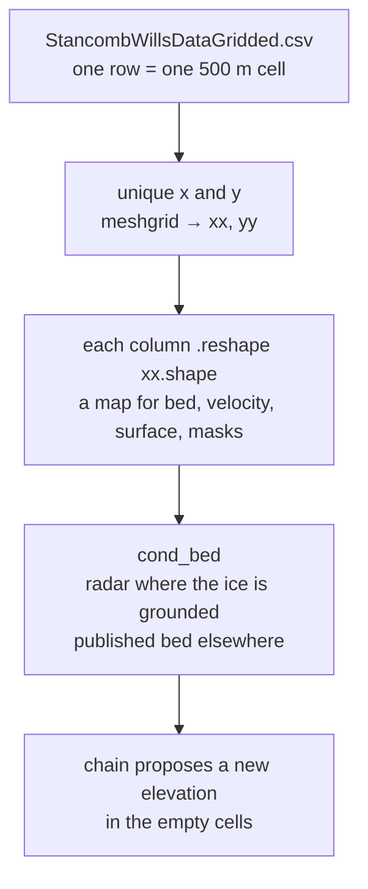

# Stancomb-Wills gridded data

`StancombWillsDataGridded.csv` is one row per map cell. Tutorial 2 turns those rows into a stack of maps that all share the same 500 m grid. This notebook's run covers 250,000 cells (500 by 500), with `x` from about −600 km to −351 km and `y` from about 1,350 km to 1,600 km.

## One row is one cell

```text
CSV                          reshaped maps (all shape = xx, yy)

x, y, bed, velx, ...   →     xx, yy          coordinates of every cell
                           bed             radar bed, empty off the flight lines
                           velx, vely      ice speed
                           bedmap_surf     ice surface
                           smb, dhdt       snowfall and surface-height change
                           masks           where the chain is allowed to update
```

```text
        x increases →
      ┌─────────┬─────────┬─────────┐
y     │ bed=NaN │ bed=−80 │ bed=NaN │   only some cells have radar
↑     │ vel,surf│ vel,surf│ vel,surf│   every cell has the other layers
      ├─────────┼─────────┼─────────┤
      │ bed=−40 │ bed=NaN │ bed=−12 │
      │ vel,surf│ vel,surf│ vel,surf│
      └─────────┴─────────┴─────────┘
        each box is one CSV row, 500 m × 500 m
```

The chain proposes a new bed elevation inside those boxes. Radar cells stay as measurements. Empty `bed` cells are what get filled in.

## What each column is for

Columns Tutorial 2 reads, plus the rest of this gridded-file layout (the same 15 columns shown for the Totten gridded file).

| Column | In the file as | What it is |
| --- | --- | --- |
| `x`, `y` | a number on every row | cell center, meters |
| `bed` | number or empty | radar bed. Empty where no flight line crossed the cell |
| `surf` | number | ice-surface elevation |
| `velx`, `vely` | number | ice speed, east and north |
| `smb` | number | surface mass balance (snowfall, roughly) |
| `dhdt` | number | how fast the surface height is changing |
| `bedmap_mask` | 0 or 1 | grounded ice. The chain updates inside this mask |
| `highvel_mask` | true or false | the fast-ice region |
| `bedmap_surf` | number | Bedmap surface, same role as `surf` |
| `bedmap_bed` | number | published Bedmap bed, a reference map |
| `bedmachine_thickness` | number | BedMachine ice thickness |
| `bedmachine_bed` | number | published BedMachine bed |
| `bedmachine_source` | code | where BedMachine got that cell's thickness |

`cond_bed` is not in the file. The notebook builds it: radar `bed` where `bedmap_mask` is 1, and a published bed everywhere else.

## How the notebook stacks it


